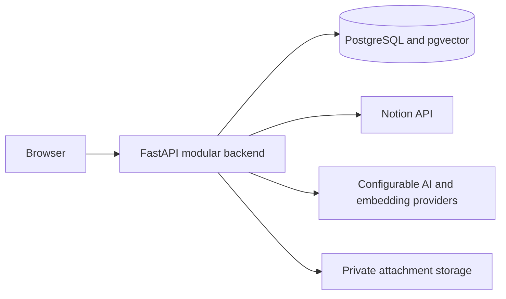

# Architecture

## Baseline
Single-tenant self-hosted modular monolith. Monorepo: backend FastAPI/Python; frontend React, TypeScript, Tailwind CSS, Vite proposed; PostgreSQL with pgvector, SQLAlchemy and Alembic; Pydantic contracts; Docker Compose; Pytest, Playwright, Locust, Ruff, ESLint, TypeScript strict, GitHub Actions. Redis/Celery deferred until measured need. REST versioning and SSE are proposed technical defaults for streaming.

## Boundaries
Identity/setup, organization and authorization, tickets/messages, routing, AI adapters, knowledge/RAG, SLA/notifications, attachments and audit. Domain services enforce transitions and access; repositories persist; integrations handle external APIs. Provider responses are untrusted and validated before actions. AI cannot write arbitrary ticket states or bypass permissions.

## Knowledge pipeline
Master configures source and credentials. Sync fetches authorized Notion content, normalizes, chunks, versions, embeds and indexes by collection/department; retrieval filters authorization before similarity search. Manual and scheduled sync, idempotent updates and removal/revocation handling recommended. Embedding provider independent from response model; changing dimensionality requires reindex and safe index cutover. No raw internal links to requester. Custom providers must implement compatible capabilities; unsupported vision or embeddings rejected explicitly.

## Persistence model
Organization, users, roles, permissions, invitations, departments/memberships, categories, schedules/SLA policies, tickets/statuses, messages/revisions, attachments, assignments, internal notes, classifications, events, feedback, provider configurations, documents/chunks and sync runs. Store secrets encrypted with deployment-supplied key; avoid public attachment URLs. Proposed private S3-compatible storage; decision pending. Audit records must not contain raw secrets.

## Reliability and security
Transactional protocol creation and active limit, validated transitions, retries/timeouts, rate limits, bounded attachments, secure session handling, prompt injection isolation, authorized retrieval, no secret logging. Human support should remain usable during AI outage (recommended). Health checks distinguish app/db/provider readiness. Production backup plan needed even though backup UI is deferred. Local and cloud use same container configuration.
