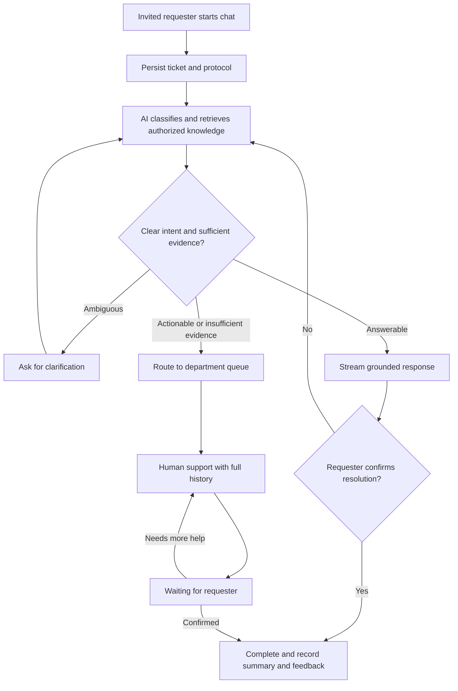

# Workflows

## Request lifecycle

Explicit human request bypasses automated answering. AI stops autonomous chat at handoff. No inactivity expiration. Cancellation is available to requester; authorized admin can force closure with reason; authorized agent/admin may reopen.

## Illustrative cases
- IT: password-reset question with sufficient authorized knowledge is answered and closed only after confirmation.
- Maintenance: machine repair request is routed to configured maintenance queue; agent responds and awaits confirmation.
- HR: leave-policy question uses authorized department knowledge without exposing the internal Notion URL; if uncertain, escalate.
These departments are examples, not seeded mandatory departments.

## State transitions
AI support → human support or waiting for requester or completed after confirmation; human support → waiting for requester; waiting → previous support mode or completed; active → cancelled by requester; completed/cancelled → human support by authorized agent/admin subject to policy. Administrative override is audited. Custom statuses map to core states; SLA pause behavior is pending.
